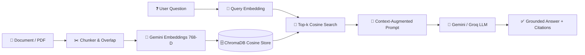

# 🧠 RAG Document Intelligence & Learning Lab

An interactive, educational, production-ready **Retrieval-Augmented Generation (RAG)** platform built with Python, Streamlit, ChromaDB, and Google Gemini.

Upload PDFs, Markdown, or text files and ask questions grounded strictly in your documents. Explore how chunking, embeddings, vector indexing, and grounded prompting eliminate hallucinations.

---

## 🚀 Key Features

- **💬 Grounded Document Chat**: Ask questions answered exclusively from your uploaded documents, complete with similarity score percentages and chunk citations.
- **⚡ 1-Click Sample Loader**: Instant test button pre-loads `sample.txt` into the vector store so anyone can start exploring without uploading files first.
- **💡 Quick Prompt Chips**: One-click starter questions ("What is RAG?", "Why chunk overlap?", "How does RAG prevent hallucinations?").
- **🔬 Live Chunk Inspector & Playground**: Interactive sandbox allowing you to adjust **Chunk Size** and **Chunk Overlap** in real-time to visually inspect how text is cut and where boundaries overlap.
- **🧭 Step-by-Step RAG Visualizer**: Interactive walkthrough of all 6 stages of the RAG lifecycle (Ingestion → Chunking → Embeddings → Vector Indexing → Retrieval → Grounded Prompting).
- **📚 Interactive Concept Glossary**: Educational cheat sheet explaining vectors, cosine similarity, top-$k$ tuning, hallucinations, and vector databases.
- **🔍 Full Injected Prompt Inspector**: Inspect the exact prompt template and augmented context delivered to the LLM.
- **🛡️ Multi-Key & Multi-Model Fallback**: Automatic rotation across multiple Gemini API keys and backup LLMs (Groq Llama-3.3-70B).
- **📥 Chat Export**: Download conversation logs and source citations as Markdown.

---

## 🏗️ Architecture Pipeline



---

## 🛠️ Technology Stack

- **Frontend & App Framework**: [Streamlit](https://streamlit.io/) with modern custom CSS styling and responsive layout.
- **Vector Database**: [ChromaDB](https://www.trychroma.com/) (ephemeral in-memory collection with cosine similarity).
- **Embeddings**: Google Gemini API (`gemini-embedding-001`, 768-dimensional semantic vectors).
- **LLM Engine**: Google Gemini API (`gemini-3.5-flash-lite`, `gemini-3.8-flash`) with optional fallback to [Groq](https://groq.com/) (`llama-3.3-70b-versatile`).
- **PDF Extraction**: `pypdf` for text parsing.

---

## ⚡ Quickstart

### 1. Clone & Install Dependencies
```bash
git clone https://github.com/muniswami-y/chat-with-your-documents.git
cd chat-with-your-documents
pip install -r requirements.txt
```

### 2. Configure API Keys
Copy the example environment file and add your Google Gemini API key:
```bash
cp .env.example .env
```
Inside `.env`:
```ini
GEMINI_API_KEY=your_gemini_api_key_here
GEMINI_MODELS=gemini-3.5-flash-lite,gemini-3.8-flash
EMBED_MODEL=gemini-embedding-001
```

### 3. Run the Application
```bash
streamlit run app.py
```
Open your browser at `http://localhost:8501`.

---

## 🌐 Deploy to Render (100% Free & 24/7 Alive)

This repository is pre-configured with [`render.yaml`](render.yaml), [`Dockerfile`](Dockerfile), and a built-in keep-alive worker to ensure instant loading without cold starts.

### Method 1: Automatic Blueprint (Recommended)
1. Push this repository to your GitHub account.
2. Log in to [Render.com](https://render.com).
3. In the Render Dashboard, click **New +** → **Blueprint**.
4. Connect your `chat-with-your-documents` repository.
5. Render will automatically detect [`render.yaml`](render.yaml) and configure:
   - **Build Command**: `pip install --upgrade pip && pip install -r requirements.txt`
   - **Start Command**: `streamlit run app.py --server.port $PORT --server.address 0.0.0.0`
   - **Health Check Path**: `/_stcore/health`
6. Under Environment Variables, input your `GEMINI_API_KEY`.
7. Click **Apply** to deploy!

### Method 2: Manual Web Service
1. Click **New +** → **Web Service** → Connect your GitHub repo.
2. Settings:
   - **Runtime**: `Python`
   - **Build Command**: `pip install --upgrade pip && pip install -r requirements.txt`
   - **Start Command**: `streamlit run app.py --server.port $PORT --server.address 0.0.0.0`
3. Add Environment Variables:
   - `GEMINI_API_KEY`: `your_gemini_api_key`
   - `GEMINI_MODELS`: `gemini-3.5-flash-lite,gemini-3.8-flash`
   - `EMBED_MODEL`: `gemini-embedding-001`
4. Click **Deploy Web Service**.

---

## ⚡ How to Make it 24/7 Alive with 0 Cold Starts (Never Sleep)

Render's free tier automatically spins down web services after 15 minutes of inactivity. We provide two mechanisms to keep your app warm and fast 24/7:

1. **Automatic Self-Ping**: The app automatically detects `RENDER_EXTERNAL_URL` and runs an internal background thread ([`rag/keep_alive.py`](rag/keep_alive.py)) that pings `/_stcore/health` every 9 minutes to reset Render's sleep timer.
2. **External Keep-Alive (Zero Downtime Guarantee)**:
   - Create a free account on [UptimeRobot](https://uptimerobot.com/) or [cron-job.org](https://cron-job.org/).
   - Add a new **HTTP(s) Monitor**:
     - **URL**: `https://<your-render-app-name>.onrender.com/_stcore/health`
     - **Interval**: Every 5 or 10 minutes.
   - This ensures your app stays in RAM 24/7 and loads in under 1 second for any user worldwide!

---

## ☁️ Alternative: Deploy Free to Streamlit Community Cloud

1. Push this repository to GitHub.
2. Go to [share.streamlit.io](https://share.streamlit.io/) and click **Create app**.
3. Pick your repository, branch `main`, and main file `app.py`.
4. Under **Advanced settings → Secrets**, paste:
   ```toml
   GEMINI_API_KEY = "your_key_1,your_key_2"
   GEMINI_MODELS = "gemini-3.5-flash-lite,gemini-3.8-flash"
   ```
5. Click **Deploy!**

---

## 📁 Repository Structure

```
├── app.py                  # Main Streamlit UI with 4 interactive learning tabs
├── rag/
│   ├── __init__.py         # Module initialization
│   ├── config.py           # Multi-key and model configuration manager
│   ├── loader.py           # Document extraction (PDF, TXT, MD)
│   ├── chunker.py          # Overlapping sliding window text chunker with metadata
│   ├── embeddings.py       # Gemini batch vector embedding client
│   ├── vectorstore.py      # ChromaDB vector store wrapper & inspection methods
│   ├── llm.py              # Gemini & Groq multi-model fallback generator
│   └── pipeline.py         # End-to-end ingest() and answer() pipeline
├── samples/
│   └── sample.txt          # Ready-to-use sample RAG guide for instant 1-click testing
├── requirements.txt        # Python package dependencies
├── .env.example            # Environment variables template
└── README.md               # Documentation and learning guide
```

---

## 🎓 Core RAG Parameters Explained

| Parameter | Recommended Default | Impact on Retrieval Quality |
| :--- | :--- | :--- |
| **Chunk Size** | `800` characters | **Small (200-400)**: High precision, less noise, but may lose context.<br>**Medium (600-1000)**: Balanced paragraph-level comprehension.<br>**Large (1200+)**: Rich context, but risks diluting similarity search. |
| **Chunk Overlap** | `150` characters | Overlaps consecutive chunks to guarantee sentences cut at the boundary are not split or lost. |
| **Top-$k$ Chunks** | `4` chunks | Dictates how many matching chunks are fed into the prompt. Too few can miss multi-part answers; too many can cause the model to lose focus. |

---

## 👤 Author
Built by **Muniswami Y**
